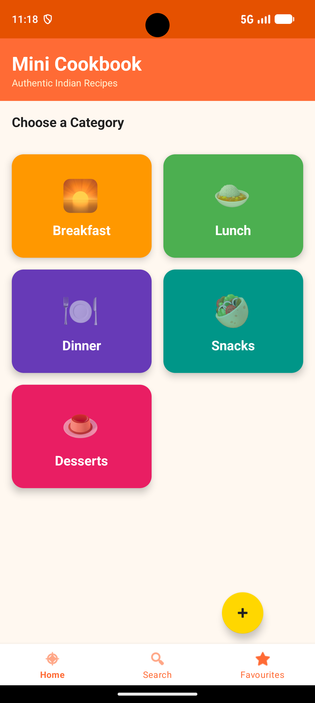
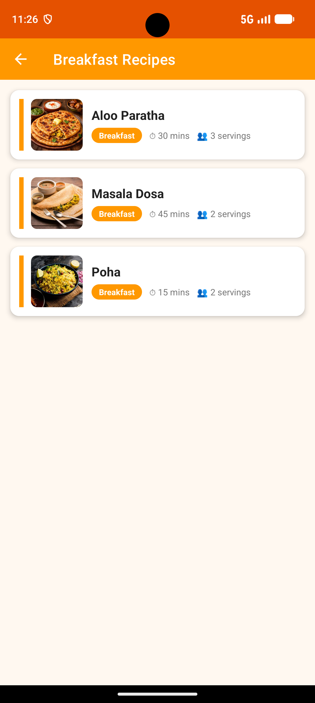
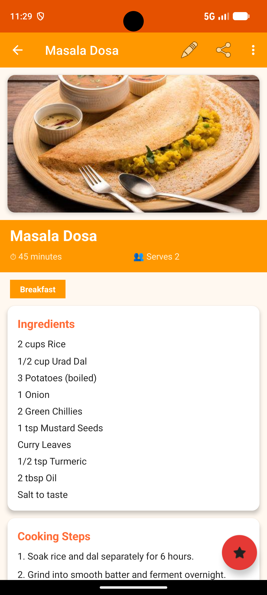
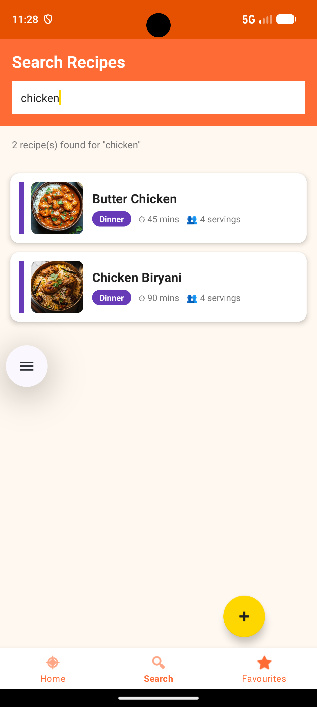

# 🍲 MiniCookbookApp

An Android application for browsing, searching, saving, and managing Indian recipes.


---

## 📖 About

MiniCookbook is a recipe app with a category-based home screen. Recipes are organized into **Breakfast**, **Lunch**, **Dinner**, **Snacks**, and **Desserts**. Users can browse recipe details, search for recipes, save favorites, and add or edit recipes. Recipe data is stored locally on the device using SQLite.

## 📸 Screenshots

<p align="center">
  
  
  
  
</p>

## ✨ Features

- **Recipe categories** – Browse recipes by meal category.
- **Recipe details** – View ingredients, cooking steps, cooking time, and servings.
- **Search** – Find recipes by name or ingredient.
- **Favorites** – Save recipes to a favorites list.
- **Add and edit recipes** – Create new recipes or update existing ones.
- **Local storage** – Store recipe data on-device in an SQLite database.
- **Sample recipes** – Includes 15 sample Indian recipes across five categories.
- **Simple interface** – Category cards, recipe lists, and bottom navigation.

## 🛠️ Tech Stack

| Area | Technology |
| --- | --- |
| Language | Java |
| Platform | Android |
| IDE | Android Studio |
| Database | SQLite |
| UI | XML layouts, Activities, Fragments, RecyclerView |
| Build | Gradle |

## 🧠 Concepts Demonstrated

- Android Activities and Fragments for screen navigation.
- XML layouts for the user interface.
- RecyclerView adapters for displaying recipe lists.
- SQLite for local data storage.
- Java classes for recipe models and database operations.
- Gradle for project configuration and builds.

## 📁 Project Structure

```text
MiniCookbookApp/
├── app/
│   ├── src/main/
│   │   ├── java/com/cookbook/miniapp/
│   │   │   ├── activities/     # App screens
│   │   │   ├── adapters/       # List adapters
│   │   │   ├── database/       # SQLite helper and data access
│   │   │   ├── fragments/      # UI fragments
│   │   │   ├── models/         # Recipe data models
│   │   │   └── utils/          # Helper classes
│   │   ├── res/
│   │   │   ├── drawable/
│   │   │   ├── layout/
│   │   │   ├── menu/
│   │   │   └── values/
│   │   └── AndroidManifest.xml
│   └── build.gradle
├── gradle/
├── .gitignore
├── build.gradle
├── gradle.properties
├── settings.gradle
└── README.md
```

## 🚀 Getting Started

### Prerequisites

- [Android Studio](https://developer.android.com/studio)
- Android SDK configured through Android Studio
- An Android emulator or a physical Android device

### Run the App

1. Clone the repository:

   ```bash
   git clone https://github.com/cgupta21/MiniCookbookApp.git
   ```

2. Open Android Studio and choose **Open**, then select the `MiniCookbookApp` folder.
3. Wait for Gradle sync to finish.
4. Select an emulator or connect an Android device.
5. Click **Run ▶** to build and launch the app.

## 💾 Data Storage

The app uses a local SQLite database named `cookbook.db`. Recipe data is stored on the device, so the app does not require a remote database server.

## 🔮 Future Enhancements

- User-uploaded recipe images
- Filters for cooking time
- Meal planning
- Cloud backup and synchronization

## 👤 Author

Built by [cgupta21](https://github.com/cgupta21).

## 📄 License

This is a personal learning project. Feel free to explore the code.
